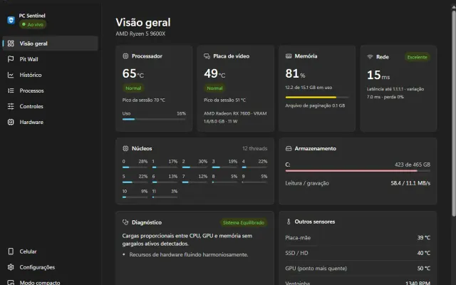
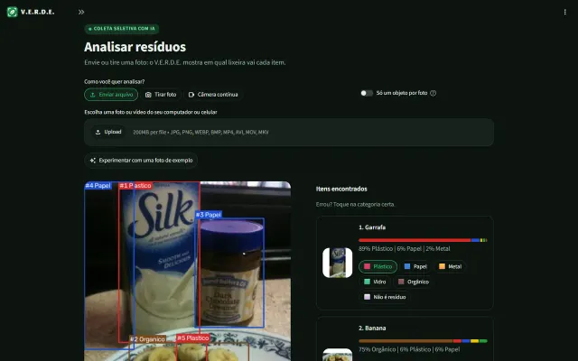
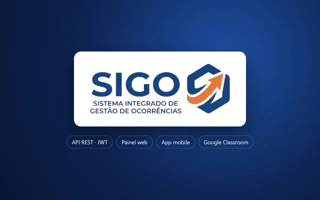
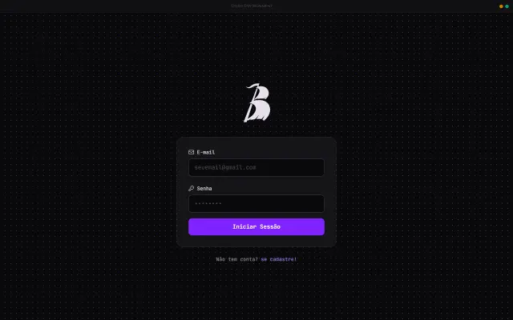

<div align="center">



<br />

<a href="https://arthur-cintra.vercel.app"></a>
<a href="https://www.linkedin.com/in/arthur-cintra-46b680329/"></a>
<a href="mailto:acintra504@gmail.com"></a>
<a href="https://gitlab.com/ThurCintra"></a>


</div>

<br />


<table>
<tr>
<td width="62%" valign="top">

- 🎓 Termino o **Técnico em Desenvolvimento de Sistemas no SENAI** em dez/2026
- 🏛️ Começo **Ciência da Computação no Uni-Facef** em fev/2027
- 💼 **Aprendiz Técnico na Seara** desde out/2025, selecionado pelo desempenho no SENAI
- 🧠 Interesses: **Inteligência Artificial** e **Cibersegurança**
- 🔭 Procurando **estágio ou vaga júnior**: desenvolvimento, hardware, automação ou e-commerce
- 🌎 Português nativo · Inglês intermediário

</td>
<td width="38%" valign="top">

```js
const arthur = {
  local: "Franca, SP",
  foco: ["IA", "Cibersegurança"],
  stack: ["React", "Node.js",
          "Python", "Electron", "C#"],
  status: "aberto a estágio",
};
```

</td>
</tr>
</table>


<table>
<tr>
<td width="50%" valign="top">
<a href="https://github.com/ThurCintra/pc_tensor"></a>
<h3><a href="https://github.com/ThurCintra/pc_tensor">🖥️ PC Sentinel</a></h3>
Monitor de hardware para Windows: temperatura e uso de CPU, GPU, RAM, discos e rede em tempo real, alertas de aquecimento, acesso pelo celular via QR Code, instalador e atualização automática.
<br /><br />
<code>Electron</code> <code>React</code> <code>C#/.NET</code> <code>Vitest</code> <code>GitHub Actions</code>
</td>
<td width="50%" valign="top">
<a href="https://github.com/ThurCintra/V.E.R.D.E"></a>
<h3><a href="https://github.com/ThurCintra/V.E.R.D.E">♻️ V.E.R.D.E.</a></h3>
Visão computacional que classifica resíduos nas 5 categorias da coleta seletiva, conta os itens em vídeo, guarda histórico e calcula o impacto ambiental.
<br /><br />
<code>Python</code> <code>YOLOv8</code> <code>Streamlit</code> <code>FastAPI</code> <code>Docker</code>
</td>
</tr>
<tr>
<td width="50%" valign="top">
<a href="https://github.com/kauanbgs/carometro"></a>
<h3><a href="https://github.com/kauanbgs/carometro">🏫 Carômetro (SIGO)</a></h3>
Gestão de turmas, alunos e ocorrências do SENAI, com API, painel web, app mobile e importação do Google Classroom. Equipe de 4: fiquei com banco de dados, JWT e telas do app.
<br /><br />
<code>Node.js</code> <code>Express</code> <code>MySQL</code> <code>JWT</code> <code>React Native</code>
</td>
<td width="50%" valign="top">
<a href="https://github.com/kauanbgs/osiris"></a>
<h3><a href="https://github.com/kauanbgs/osiris">🤖 Osíris</a> <sub><code>em finalização</code></sub></h3>
Plataforma de IA com chat, modelos locais, agentes e workflows visuais (web, desktop e mobile). Equipe de 6: fiquei com o app mobile.
<br /><br />
<code>React</code> <code>React Native</code> <code>Expo</code> <code>Electron</code> <code>Node.js</code>
</td>
</tr>
</table>


<div align="center">

**Linguagens**<br />


**Front-end, back-end e dados**<br />


**Desktop, hardware e DevOps**<br />


**IA no dia a dia**<br />


</div>


<div align="center">

<!-- A cobrinha é gerada pelo workflow .github/workflows/snake.yml (branch "output"). -->
<picture>
  <source media="(prefers-color-scheme: dark)" srcset="https://raw.githubusercontent.com/ThurCintra/ThurCintra/output/github-snake-dark.svg" />
  
</picture>

</div>

<br />


